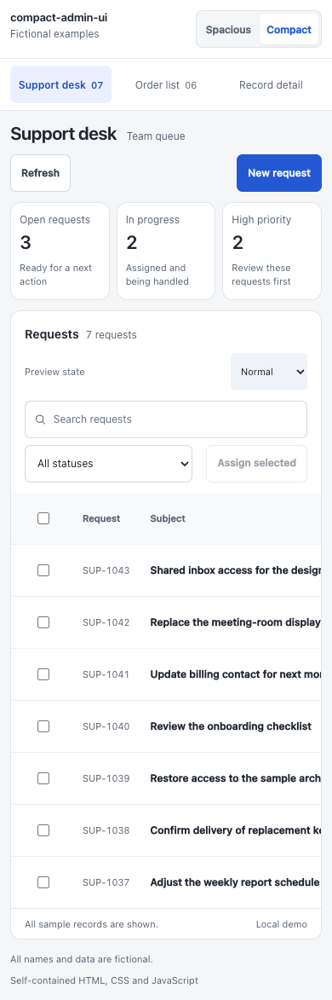

# compact-admin-ui

Compact, readable business interfaces for people who have work to do.

[中文说明](README.zh-CN.md) · [Skill instructions](SKILL.md) · [Example prompts](examples/prompts.md) · [MIT license](LICENSE)

An independent [Agent Skill](https://agentskills.io/specification) for refining spacing, tables, filters, forms, and record details. It favors clear hierarchy, useful density, restrained surfaces, and complete interaction states. It does not require a particular framework, component library, or another design skill.

## See the difference

The same fictional support queue, data, and viewport, with only its spacing and density changed:

| Spacious | Compact |
| --- | --- |
|  |  |

These are authored examples, not an agent benchmark or a claim that denser interfaces are always better. The source includes support, order-list, and record-detail examples, with search, filters, local actions, keyboard-accessible dialogs, and simulated loading, empty, and error states.

## Install

With the [Skills CLI](https://github.com/vercel-labs/skills):

```sh
npx skills add lxshwyan/compact-admin-ui --skill compact-admin-ui
```

To inspect the available skill before installing:

```sh
npx skills add lxshwyan/compact-admin-ui --list
```

Alternatively, copy this repository into a `compact-admin-ui` directory in your agent's supported skills location. Keep `SKILL.md`, `references/`, and the other bundled files together.

This skill is intended for explicit use. The included Codex policy disables implicit invocation where that policy is supported; other clients may select skills differently. Follow your client's documentation for invocation syntax.

## Use

```text
Use $compact-admin-ui to tighten this admin table page.
Inspect cumulative spacing first. Preserve the existing components,
brand, permissions, and behavior. Verify desktop and narrow layouts.
```

```text
用 $compact-admin-ui 优化这个后台页面：减少块之间重复的留白，
保持文字清晰、操作可见，复用现有组件，并检查手机布局和键盘焦点。
```

See [more prompts](examples/prompts.md) and [acceptance checks](references/acceptance.md).

## What it changes

- Spacing follows relationships: close within a task, more separation between tasks.
- Short panels fit their content; every block does not need another padded card.
- Static panels use restrained borders; floating surfaces earn elevation.
- Tables retain readable text, aligned numbers, and visible actions.
- Small edits stay inline; record inspection and substantial editing use appropriate surfaces.
- Loading, selection, validation, empty results, focus, and recovery belong to the design.

Defaults are starting points. Existing project tokens and explicit user choices take precedence. This is a visual and interaction brief, not a replacement for business requirements, accessibility testing, or a component library.

## Run the examples

Open [examples/index.html](examples/index.html) directly in a browser. No installation, build, network connection, or service is needed. For a local HTTP server, run this command from the repository root:

```sh
python3 -m http.server 8000 --bind 127.0.0.1
```

Then open `http://127.0.0.1:8000/examples/`. Use the example selector, spacious/compact switch, search, filters, and state selector. Actions modify in-memory demo data and reset on reload. Every organization, person, record, date, and value is fictional.



## Repository map

| Path | Purpose |
| --- | --- |
| `SKILL.md` | Discoverable skill entrypoint and core decisions |
| `agents/openai.yaml` | Codex display metadata and explicit-use policy |
| `references/` | On-demand work patterns and acceptance checks |
| `examples/` | Runnable examples, prompts, and their design contract |
| `assets/` | Screenshots captured from the examples |

## Development and contributions

Keep examples synthetic and self-contained. Changes should explain the task they improve, preserve the public invocation boundary, and include screenshots when changing the demo. See [CONTRIBUTING.md](CONTRIBUTING.md).

Version 0.1.0 is an initial release. The screenshots show the supplied implementation; output from other agents, frameworks, and products still needs review. Cross-agent compatibility should be verified in the target client rather than assumed from the file format alone.

## Related work and license

The skill uses the open Agent Skills format. Broader design workflows such as [Impeccable](https://github.com/pbakaus/impeccable) can use it as a style brief; no dependency or endorsement is implied. Its business-interface guidance and fictional examples are maintained in this repository rather than importing another skill's runtime or assets.

Code, skill instructions, documentation, and supplied example assets are available under the [MIT license](LICENSE).
