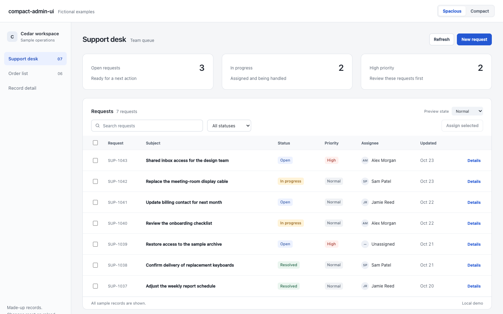
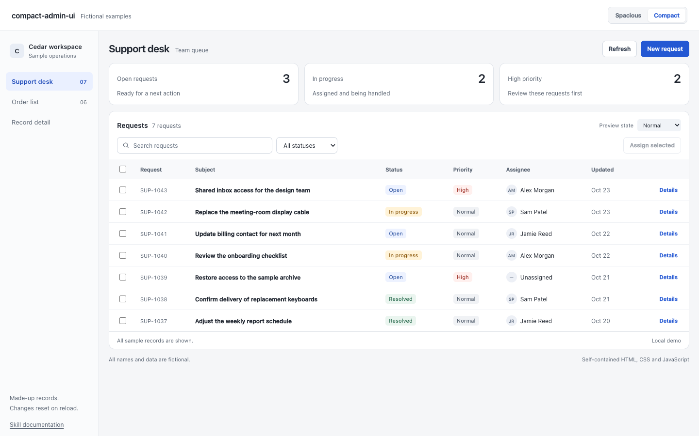

# compact-admin-ui

面向日常业务操作的紧凑后台界面技能。

[English](README.md) · [技能正文](SKILL.md) · [示例提示词](examples/prompts.md) · [MIT 许可证](LICENSE)

它主要处理块间距、表格密度、筛选区、表单、记录详情和交互状态。目标是让相关信息靠近、主要工作尽早出现，同时保持文字清楚、操作可见。可独立使用，不绑定框架、组件库或其他设计技能。

## 效果示例

同一份虚构工单数据、同一视口，仅切换留白与密度：

| 疏松布局 | 紧凑布局 |
| --- | --- |
|  |  |

这些是随仓库提供的演示页面，不是智能体能力排行榜或效率提升实验。密度应服务于任务，并非越紧凑越好。

## 安装与调用

```sh
npx skills add lxshwyan/compact-admin-ui --skill compact-admin-ui
```

只查看仓库中的技能，不安装：

```sh
npx skills add lxshwyan/compact-admin-ui --list
```

也可将整个仓库复制到所用智能体支持的技能目录下，文件夹名保持 `compact-admin-ui`。

此技能以明确调用为使用边界。支持 `agents/openai.yaml` 策略的 Codex 客户端会关闭隐式调用；其他客户端的选择规则可能不同。

```text
用 $compact-admin-ui 优化这个后台页面。先检查 gap、margin、padding
和固定高度叠加造成的留白，保留已有组件、品牌、功能与权限，
不要靠缩小文字塞入内容，并检查手机布局和键盘操作。
```

项目现有设计规范和用户明确要求优先于技能中的默认数值。已有的综合设计流程可继续使用，把本技能作为当前工作区的风格约束即可。

## 核心取舍

- 按信息关系确定间距，避免父子容器重复留白。
- 卡片根据内容决定高度；相关内容可以用行和分隔线组织。
- 静态面板以轻边框为主，弹层再使用适度阴影。
- 保持表格文字、状态、金额和操作的可读性与对齐。
- 根据编辑范围选择行内、抽屉、详情页或对话框。
- 处理加载、刷新、无结果、错误、选中与键盘焦点状态。
- 保留确实有用的说明，删除重复的教学式文案。

## 查看交互示例

直接用浏览器打开 [examples/index.html](examples/index.html)。也可以在仓库根目录启动仅本机可访问的静态服务：

```sh
python3 -m http.server 8000 --bind 127.0.0.1
```

随后打开 `http://127.0.0.1:8000/examples/`。

示例包含工单台、订单列表和记录详情，可切换疏松/紧凑布局、搜索、筛选及加载/空结果/错误状态。所有名称和记录都是专门编写的虚构数据，不连接生产服务；操作仅修改内存，刷新后恢复。

## 状态与参与

当前为 0.1.0 初始版本。随附截图只证明这些示例的表现；其他智能体、框架与实际产品仍需单独验收。格式兼容不代表所有客户端的调用行为都已验证。

提交问题时，请提供复现步骤、视口大小和脱敏后的界面。贡献约定见 [CONTRIBUTING.md](CONTRIBUTING.md)。代码、文档、技能指令和示例资源均采用 [MIT 许可证](LICENSE)。
